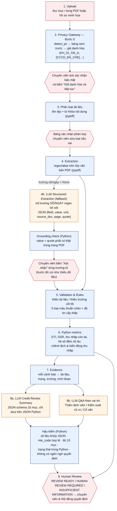

# Sơ đồ workflow — CreditLens (AI Credit Underwriting Copilot)

Sơ đồ toàn bộ pipeline của bản Streamlit (UI v3). Màu xanh: Python tự làm, kết quả xác định. Màu cam: có gọi LLM. Màu đỏ: con người phải duyệt.

## AI tự làm gì, con người duyệt gì

| Bước | Ai thực hiện | Con người phải duyệt? |
|---|---|---|
| Phát hiện & giả danh hóa PII | Python (`privacy_gateway.py`) | Có — xác nhận bảng xem trước, có thể che thêm |
| Phân loại tài liệu | Python (tên tệp + từ khóa) | Có — bảng xác nhận phân loại |
| Trích xuất trường bằng regex | Python | Xem ở trang Trích xuất (có bằng chứng trang) |
| Trích xuất bổ sung bằng AI | **LLM** (1 request/hồ sơ, khi chuyên viên bấm) | **Có — từng trường phải bấm “Xác nhận”** mới được dùng để tính |
| Rules, chỉ số DTI/DSR, trạng thái | Python | Không đổi được bằng AI |
| Credit Review Summary | **LLM** + hậu kiểm Python | Có — nội dung AI chỉ hỗ trợ; vi phạm hậu kiểm thì không vào báo cáo |
| Hỏi đáp theo vai trò | **LLM** (1 request/lần Gửi) | Có — câu trả lời chứa khuyến nghị phê duyệt/từ chối bị chặn |
| Quyết định cho vay | **Chỉ con người** | Hệ thống không bao giờ APPROVE/REJECT |

## Giới hạn đã biết

- Chưa có OCR: PDF scan chỉ có ảnh không đọc được nội dung (FAIL-01) và hồ sơ sẽ ở trạng thái cần con người xem xét.
- Chưa kết nối CIC: tài liệu nghĩa vụ nợ do khách cung cấp và sao kê là nguồn đối chiếu thay thế.
- Ngưỡng là minh họa học thuật, không phải chính sách tín dụng của ngân hàng.
